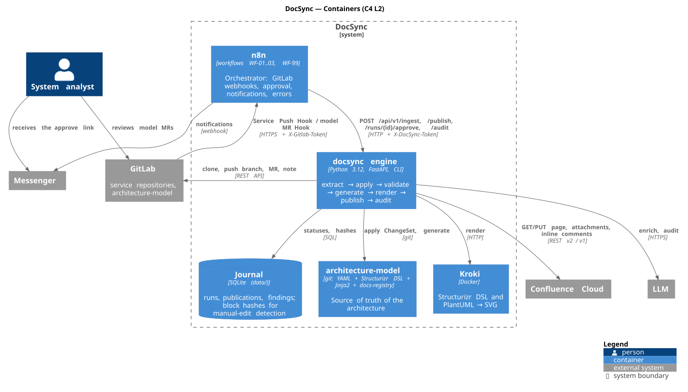
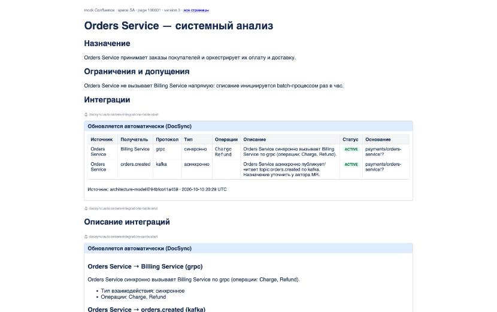

<h1 align="center">DocSync</h1>

<p align="center">
  Documentation that follows the code: integration tables, C4 and sequence diagrams in Confluence
  are regenerated from an Architecture-as-Code model whenever a service merges to <code>main</code>,
  after a human approves the change.
</p>

<p align="center">
  <a href="https://github.com/Markuysa/docsync/actions/workflows/ci.yml"></a>
  
  
  
  
  <a href="LICENSE"></a>
</p>

```
merge to main of a service ──GitLab webhook──▶ n8n ──▶ docsync engine ──▶ MR into architecture-model
                                                                                │  analyst approves
                                                                                │  (GitLab, link or Telegram button)
Confluence ◀── autoblocks: tables, C4 (Structurizr), sequence (PlantUML) ◀── publish ◀──┘
```

<p align="center"></p>

## Why

Integration descriptions, C4 diagrams and sequence scenarios go stale the moment a developer adds a gRPC call
or a Kafka topic. DocSync removes the manual rewriting without giving up control:

- **Deterministic.** Facts (relationships, protocols, operations) are extracted from code, applied to a YAML model
  in git, and every artifact is generated from that model. Same model, same diagrams, on every page.
- **Human in the loop.** Nothing reaches Confluence before the change is merged into the model repository
  through a merge request. Approval takes one click in GitLab, in the notification link or in Telegram.
- **Safe for hand-written text.** Pages are updated only inside marked autoblocks. A block edited by hand
  is reported as a conflict, never overwritten.
- **Prose is not forgotten.** An optional LLM audit finds statements in hand-written sections that the change
  made stale and leaves inline comments with a quote and a suggested wording. It never edits.
- **Architecture as Code.** C4 views live in Structurizr DSL; diagrams are rendered to SVG snapshots or embedded
  live from a Structurizr server.

## Components

| Component | Role |
|---|---|
| **docsync engine** (`docsync/`) | Python service with a CLI and an HTTP API: `extract` → `apply` → `validate` → `generate` → `render` → `publish` → `audit` |
| **n8n** (`n8n/`) | Thin orchestrator: GitLab webhooks, engine calls, approval link, reminders, error handling. Four workflows generated from one script |
| **architecture-model** (`architecture-model/`) | Template of the model repository: YAML cards, `workspace.dsl`, page registry, Jinja2 templates |
| **Kroki** | Renders Structurizr DSL and PlantUML to SVG |
| **Structurizr server** (optional) | Live C4 diagrams embedded into pages via iframe (`DOCSYNC_C4_MODE=structurizr`) |
| **Confluence** | `cloud` (REST v2) or `mock` (files on disk with an HTML viewer for demos and tests) |
| **Notifications** | Slack incoming webhook and a Telegram bot with Approve / Reject buttons |

## Quick start

Docker and Python 3.11+ are enough: GitLab is simulated and Confluence is mocked.

```bash
cp .env.example .env
make venv                      # .venv and dependencies
docker compose up -d --build   # n8n :5678, engine :8088, Kroki :8000
./n8n/import.sh                # import and activate the workflows
./demo/run-stack.sh            # push → proposal → approve → publish, two iterations
```

Then open http://localhost:8088/mock-confluence/ for the resulting pages, http://localhost:5678 for the workflow
executions and http://localhost:8088/docs for the engine API.

<p align="center"></p>

Without Docker: `docker run -d -p 8000:8000 yuzutech/kroki && make demo`. Tests: `make test`.

## Documentation

| Document | Content |
|---|---|
| [Overview and options](docs/01-overview.md) | The problem, three implementation options, why the hybrid was chosen |
| [Architecture](docs/02-architecture.md) | C4 context and container diagrams, components, key design decisions |
| [Pipeline](docs/03-pipeline.md) | End-to-end scenarios, run statuses, idempotency, conflicts, dry-run |
| [Model](docs/04-model.md) | Model format, `docsync.yaml` of a service, page registry, templates, C4 delivery modes |
| [n8n](docs/05-n8n.md) | Workflows, variables, GitLab webhooks, Slack and Telegram approvals |
| [Local demo](docs/06-local-demo.md) | Detailed local run and what to look at |
| [Confluence Cloud](docs/07-confluence-cloud.md) | Running against a real tenant: token, page bootstrap, dry-run, PlantUML macro |
| [Production](docs/08-production.md) | Deployment, security, limitations, extending extractor rules, roadmap |

## Repository layout

```
docsync/            engine: extractor, model, generate, render, autoblocks, confluence, githost,
                    journal, llm, structurizr, notify, telegram, pipeline, api, cli, demo
docsync/schemas/    JSON Schema: ChangeSet, integration card, docs-registry
docsync/prompts/    LLM prompts: ChangeSet enrichment, audit of hand-written sections
architecture-model/ model repository template (copied into data/repos by `docsync demo seed`)
n8n/                build_workflows.py → workflows/*.json, import.sh
ci/                 .gitlab-ci.yml for the model repository, service webhook guide
demo/               end-to-end demo through n8n
docs/               documentation, diagrams (puml + svg/png), examples
tests/              pytest
```

Documentation, CLI, scripts and notifications are in English. The content DocSync writes into Confluence
(panel titles, table headers, generated descriptions, demo pages) is in Russian, the language of the target
documentation space; it lives in `architecture-model/templates/*.j2`, `docsync/generate.py`, `docsync/llm.py`
and `docsync/prompts/*.md`.

## License

[MIT](LICENSE)
