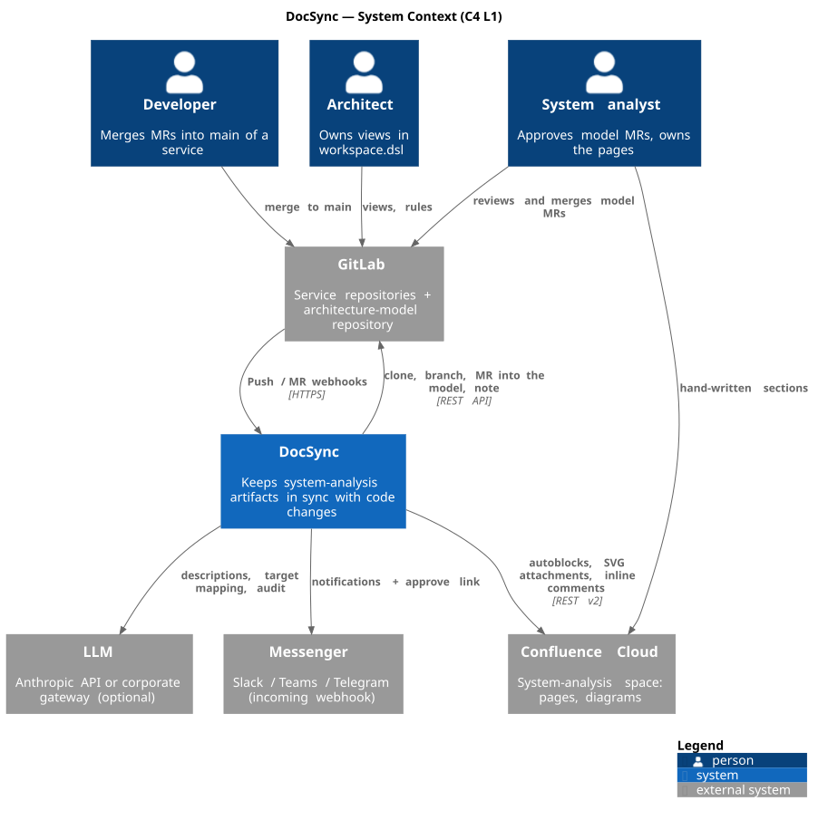

# 2. Architecture

## Context (C4 L1)



## Containers (C4 L2)


| Container | Technology | Responsibility |
|---|---|---|
| n8n | n8n 2.x, 4 workflows | Receives GitLab webhooks (checks `X-Gitlab-Token`), calls the engine, notifications, approve link, reminders, error handler |
| docsync engine | Python 3.12, FastAPI, httpx, Jinja2, PyYAML, jsonschema | All domain logic. HTTP API for n8n + CLI for humans and CI |
| architecture-model | git repository | Source of truth: YAML cards, `workspace.dsl`, `docs-registry.yaml`, templates, `changesets/` (audit trail) |
| Kroki | Docker `yuzutech/kroki` | Structurizr DSL (`view-key`) and PlantUML → SVG |
| Journal | SQLite in `data/` | Runs, publications (block hashes), audit findings. Idempotency and manual-edit detection |
| Confluence | Cloud REST v2 (+v1 for attachments) or mock | Pages with autoblocks, SVG attachments, inline comments |

## Engine modules

```
docsync/
  extractor.py   facts from two git revisions (regex rules: gRPC Java/Kotlin/Go/Python, Kafka, HTTP, migrations) → ChangeSet
  model.py       YAML model loading, apply ChangeSet, validate (JSON Schema + referential integrity + registry)
  generate.py    Structurizr DSL (elements/relationships + inlined workspace), PlantUML sequence, XHTML autoblocks, manifest.json
  render.py      Kroki: structurizr (view-key) / plantuml → SVG
  structurizr.py Structurizr server: push the workspace (structurizr-cli), iframe embed macro for C4 blocks (DOCSYNC_C4_MODE=structurizr)
  autoblocks.py  replacement of content between docsync:auto:<id>:start/end anchors; invariants (see below)
  confluence.py  CloudConfluence (REST v2/v1) and MockConfluence (files + HTML viewer), shared interface
  githost.py     LocalGitHost (git on disk) and GitLabHost (clone, push, MR, merge, note)
  journal.py     SQLite: run, publication, finding
  llm.py         Anthropic SDK / OpenAI-compatible gateway / none; enrich and audit with structured JSON output
  pipeline.py    scenarios ingest / approve / publish / audit / bootstrap - the only place where everything is wired together
  api.py         FastAPI: /api/v1/ingest, /publish, /runs, /runs/{id}/approve, /audit, /confluence/bootstrap, /notify, /mock-confluence
  cli.py         docsync extract|validate|generate|render|ingest|approve|publish|audit|runs|confluence|serve|demo
  notify.py      notification fan-out: log, Slack incoming webhook, Telegram
  telegram.py    Telegram bot: Approve/Reject buttons, long polling, /pending, /status
  demo.py        sample repositories (3 commits), GitLab Push Hook simulation
```

## Key decisions

**1. Logic lives in the engine, not in n8n.** n8n is great at receiving webhooks, waiting for humans and sending notifications; 300 lines of JS inside a workflow JSON cannot be unit-tested or reviewed. DocSync workflows are 4–8 nodes each, every engine call is a plain HTTP Request. They are generated by a script so that node versions and connections are reproducible.

**2. Autoblocks with anchors.** The analyst places a pair of anchor macros `docsync:auto:<blockId>:start/end` on the page once (`docsync confluence bootstrap` does it). DocSync replaces everything between them inclusively and checks three invariants before the PUT:
* the hash of the page **outside** autoblocks did not change (otherwise an exception - nothing is published);
* the hash of the current block content equals the hash of the last publication (otherwise the block was edited by hand → `CONFLICT`, the block is skipped, the others are published, the run becomes `PARTIALLY_PUBLISHED`);
* the resulting storage format has balanced tags.

**3. Model in git, publish after merge.** The engine never writes to Confluence on a service push. It opens an MR in `architecture-model`; publishing is triggered by the merge webhook of that MR (or by the approve link, which merges through the API). Any manual model edit by an architect merged to `main` is also published - the push webhook on the model repository.

**4. Structurizr DSL as the single source of C4.** `model/**/*.yaml` → `model/generated/{elements,relationships}.dsl` (committed to git, so the repository is a complete Structurizr workspace) → inlined into `workspace.dsl`. Two delivery modes: Kroki renders the requested `view-key` to an SVG attachment, or the workspace is pushed to a Structurizr server and pages embed the live diagram via iframe (`DOCSYNC_C4_MODE`, see docs/04). The architect writes only views and styles.

**5. Sequence - PlantUML.** `model/flows/*.yaml` describes scenario steps as references to integration cards; the `templates/sequence.puml.j2` template builds PlantUML. `DOCSYNC_DIAGRAM_MODE=macro` embeds the source into a PlantUML plugin macro (macro name is configurable) instead of an SVG attachment.

**6. Idempotency.** Run key `project_path:merge_sha` - a redelivered webhook yields `DUPLICATE`. Re-publishing without model changes yields `UNCHANGED` for every block (hashes match).

**7. The LLM is optional and constrained.** Structured JSON output against a schema; target mapping only from the list of known elements; descriptions go into the MR for review; the audit creates comments only, and only when the quote is found verbatim on the page and `confidence ≥ 0.7`.

## Data flows

| Flow | Format | Schema |
|---|---|---|
| GitLab → n8n | Push Hook / Merge Request Hook | standard GitLab payloads |
| n8n → engine | JSON over HTTP, `X-DocSync-Token` header | OpenAPI: `http://localhost:8088/docs` |
| engine → model | ChangeSet → YAML cards + `changesets/<runId>.json` | `docsync/schemas/change-set.schema.json`, `integration.schema.json` |
| model → Confluence | `build/<sha>/manifest.json`, `blocks/*.xhtml`, `diagrams/*.svg` | `docs-registry.schema.json` |
| n8n → messenger | `{text, level, source}` | compatible with Slack Incoming Webhook |
