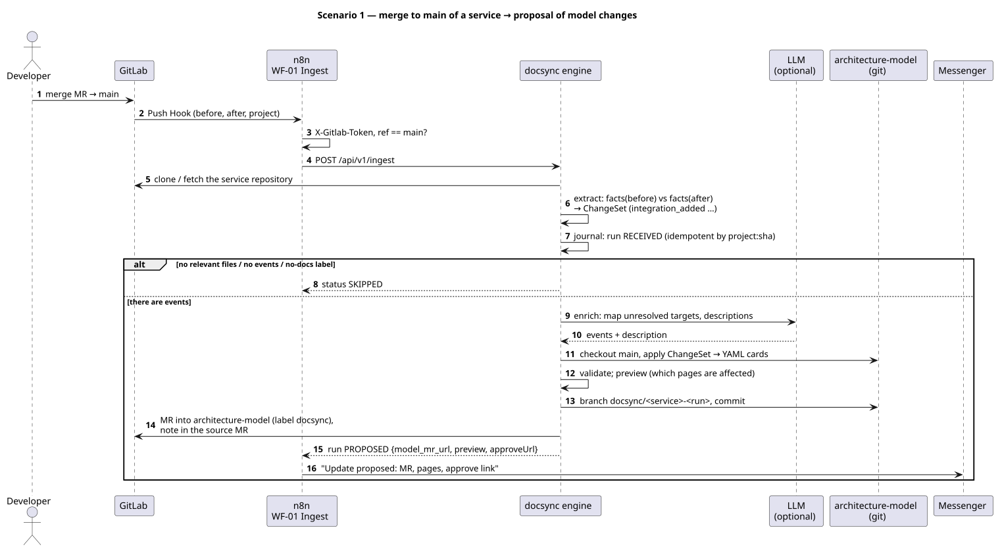
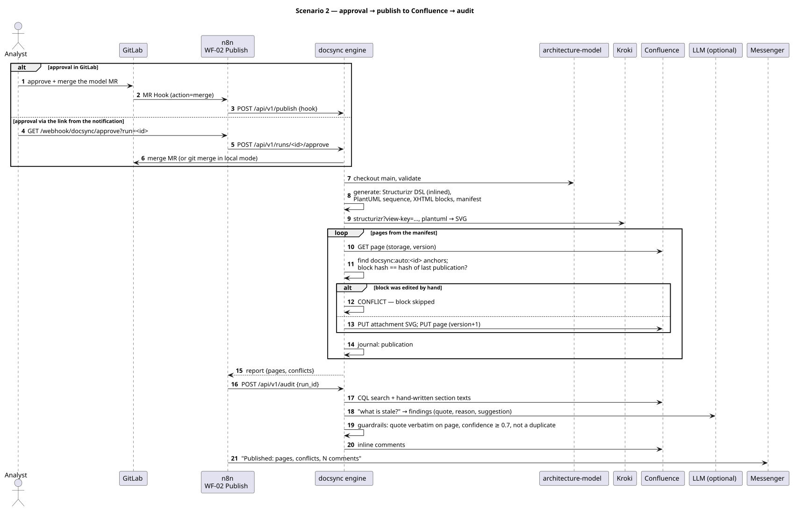
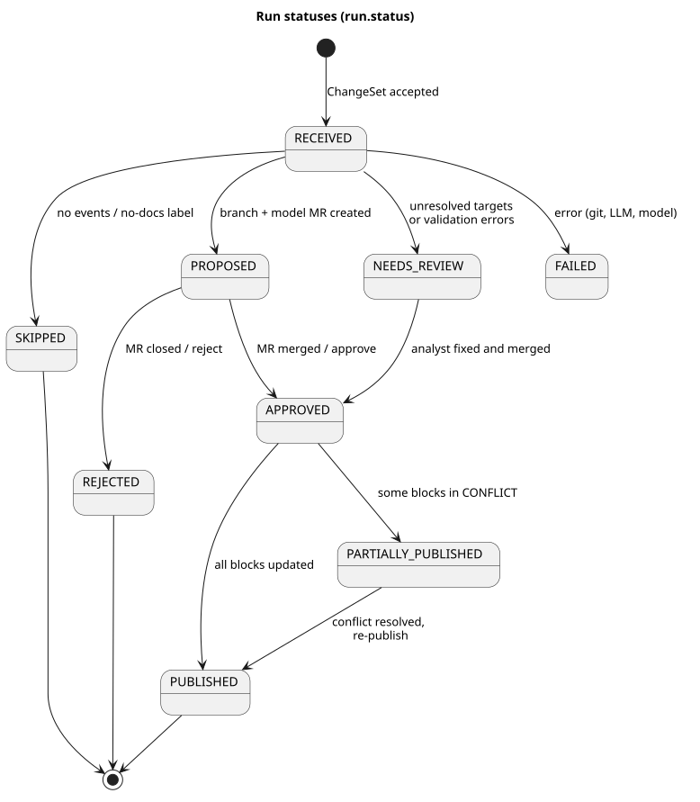

# 3. End-to-end scenarios

## Scenario 1: merge to main of a service → proposal of model changes



Engine steps (`Pipeline.ingest`):

1. **Service repository.** `gitlab` mode: clone/fetch with a token; `local` mode: path from `DOCSYNC_SERVICE_REPOS`.
2. **Extract.** Relevant files (`*.kt`, `*.java`, `*.go`, `*.py`, `*.ts`, `application*.yml`, `*.proto`, migrations) are scanned in revisions `before` and `after`; **facts** `(rule, protocol, target)` are extracted from them. The set difference of facts = events: `integration_added | integration_removed | integration_changed` (operation set changed) + `datastore_changed` (migrations). The diff text is never parsed, so file renames and formatting produce no events.
3. **Target normalization.** `BillingServiceGrpc.newBlockingStub` → `BillingService` → via the service's `docsync.yaml` → `billing-service` (confidence 1.0); kebab-case/host heuristics - 0.8–0.9; otherwise `unresolved:<raw>` (0.5) - such events land in the MR as "needs manual handling", the model is not changed.
4. **Journal.** A `run` keyed by `project:sha` - a redelivered webhook yields `DUPLICATE`. No relevant files/events, or a `no-docs` label on the MR → `SKIPPED`.
5. **LLM enrich (optional).** Description for new integrations, mapping of `unresolved` targets. Without an LLM - a templated description.
6. **Apply → validate → preview.** Cards `model/integrations/<from>__<to>__<protocol>.yaml` are created/updated (`manual.*` is never touched, `provenance` records MR/sha/source/confidence). Kafka topics are registered as external queue elements. Validation: JSON Schema, referential integrity, page registry ↔ views. Preview - the list of pages and blocks that will change.
7. **Branch and MR.** `docsync/<service>-<run8>` in `architecture-model`, file `changesets/<runId>.json`, an MR with the event table and evidence (`file:line`), label `docsync`. A note with the link is posted to the original service MR. Status `PROPOSED` (or `NEEDS_REVIEW` if there are unresolved targets/validation errors).
8. **n8n** sends a notification: service, number of changes, model MR, pages, "approve" link.

## Scenario 2: approval → publish to Confluence → audit



Two equivalent approval paths:
* **GitLab:** the analyst (possibly after fixing descriptions) merges the MR → MR Hook `action=merge` → n8n → `POST /api/v1/publish`. The engine finds the run by branch, moves it to `APPROVED` and publishes only blocks that depend on the touched elements.
* **Link from the notification:** `GET /webhook/docsync/approve?run=<id>` → `POST /api/v1/runs/<id>/approve` → the engine merges the MR through the API (`git merge` in `local` mode) and publishes.

`Pipeline.publish`:
1. `checkout main` of the model, `validate` (an invalid model stops publishing with an error).
2. `generate` into `data/build/<sha>/`: DSL, PlantUML, XHTML blocks, `manifest.json`. With `changed` - only blocks whose scope intersects the changed elements **or their neighbours** (a new Orders→Billing link refreshes both service pages and the domain matrix).
3. `render` through Kroki.
4. For every page: `GET` → `patch_page` (invariants from section 2) → `PUT attachment` for SVGs → `PUT page version+1` with the message `DocSync: architecture-model@<sha>` → read the page back → journal record.
   *Read-after-write:* Confluence Cloud rewrites storage format on save (adds `ac:macro-id`, `ac:schema-version`, `ri:version-at-save`, converts `—` to `&mdash;`, inserts whitespace between tags). Hashes are therefore computed over a normalized form (`autoblocks.normalize`) **and** from the content Confluence actually stored, so that the next run compares like with like. Verified against a real Confluence Cloud tenant: a second publish of an unchanged model is `UNCHANGED` for every block.
5. Run status: `PUBLISHED` or `PARTIALLY_PUBLISHED` (there is a `CONFLICT`/`MISSING_ANCHORS`).

`Pipeline.audit` (if the LLM is enabled): it always checks the registered pages whose scope touches the changed elements, adds pages found by CQL search (best-effort: the search index of a fresh site may lag), strips autoblocks and markup, and asks the LLM to find stale statements. Guardrails: the quote must appear verbatim on the page, `confidence ≥ 0.7`, no identical finding in the journal. Passing findings → an inline comment "DocSync: reason / suggested text". The demo model deliberately contains the sentence "Orders Service does not call Billing Service directly" (in Russian) - that is what the audit should find.

## Run statuses



## Dry-run

`DOCSYNC_DRY_RUN=true` (or `dryRun: true` on a page in the registry): everything runs, including rendering and patch computation, but no `PUT` is sent to Confluence; blocks get `SKIPPED_DRY_RUN` in the report, the page gets `DRY_RUN`. Recommended for the first run against a real Confluence.

## Publish report (example)

```json
{
  "modelSha": "94bfcc41a459…", "runId": "72e4c9d5-…", "dryRun": false,
  "pages": [
    {"key": "orders-service", "pageId": "100001", "title": "Orders Service - системный анализ", "status": "PUBLISHED",
     "url": "http://localhost:8088/mock-confluence/100001",
     "blocks": [{"blockId": "orders-integrations-table", "status": "PUBLISHED", "hashBefore": "…", "hashAfter": "…"},
                {"blockId": "payments-c4-containers", "status": "PUBLISHED"}]},
    {"key": "billing-service", "status": "PUBLISHED", "...": "..."}
  ],
  "conflicts": []
}
```

## Error handling

| Situation | Behaviour |
|---|---|
| Kroki unavailable | publish fails with a clear error before any write to Confluence; n8n WF-99 sends an alert |
| Confluence returned an error on page `GET` | the page is `FAILED` in the report, the others are published |
| Page without `pageId` in the registry | `NO_PAGE_ID` with a hint to run `docsync confluence bootstrap` |
| Manual edit inside an autoblock | `CONFLICT`, the block is left untouched; the analyst either moves the text into a manual section and re-publishes with `force` (`docsync publish --force` / `POST /api/v1/publish {"force": true}`) - DocSync takes ownership of the block again and overwrites it - or keeps the manual version (the block stays `CONFLICT` in every report until resolved) |
| Error on ingest (git, LLM, model) | the run is `FAILED` with the error text, the model working tree is rolled back, a "failed" notification is sent |
| Redelivered webhook | `DUPLICATE`, nothing happens |
