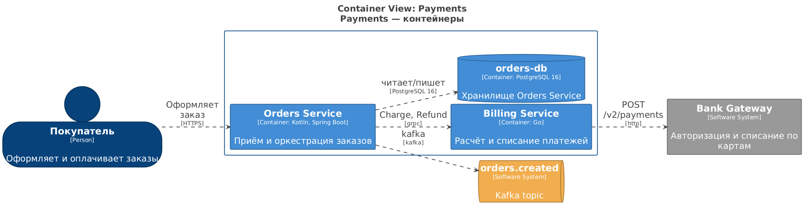

# 4. Architecture model (Architecture as Code)

The `architecture-model` repository is the source of truth. Everything visible in Confluence autoblocks is derived from it.

```
architecture-model/
  model/systems/payments.yaml                 system (domain): owner, analyst
  model/services/orders-service.yaml          service = C4 container: technology, repository, datastores, manual.notes
  model/external/bank-gateway.yaml            external system; kind: queue - a topic/queue
  model/integrations/<from>__<to>__<proto>.yaml   relationship: operations, description, nfr, status, provenance, manual
  model/flows/checkout.yaml                   scenario: participants + steps (references to integrations) → sequence
  model/generated/*.dsl                       generated, not stored in git
  workspace.dsl                               Structurizr: views + styles (architect); elements - !include generated
  docs-registry.yaml                          Confluence pages ↔ autoblocks
  templates/*.j2                              integrations-table, integration-cards (XHTML), sequence (PlantUML)
  changesets/<runId>.json                     the ChangeSet that produced the MR (audit trail)
```

## Integration card

```yaml
from: orders-service
to: billing-service
protocol: grpc              # grpc | http | kafka | rabbitmq | jdbc | s3 | other
interaction: sync           # sync | async
operations: [Charge, Refund]
description: Orders synchronously calls Billing via gRPC to charge the order.   # draft by DocSync/LLM, edited by the analyst
nfr: {timeoutMs: 5000, retries: 2}                                           # filled by the analyst
status: active              # active | deprecated (link gone from code) | needs_review (low confidence)
provenance: {mr: payments/orders-service!128, sha: 84def276, source: rule, confidence: 1.0, runId: …}
manual:                     # DocSync NEVER changes this field
  notes: ""
```

What `apply` does per event type:

| Event | Action |
|---|---|
| `integration_added` | create a card (or extend `operations` of an existing one), `status: active` at confidence ≥ 0.7, otherwise `needs_review` |
| `integration_changed` | replace `operations` with `operationsAfter` |
| `integration_removed` | `status: deprecated` (the card stays - history and highlighting in the table; `validate` will require fixing scenarios that use it) |
| `service_added` | a service card in `system: unassigned` |
| `datastore_changed` and others | the model is not changed, the event is shown in the MR as "for information" |
| target `unresolved:*` | the model is not changed, the event is listed in the MR as "needs manual handling" |

## `docsync.yaml` in the service repository

```yaml
service: orders-service              # ID in model/services
aliases:                             # raw name from code/config -> model element ID
  BillingService: billing-service    # gRPC service name from the stub
  billing.payments.svc: billing-service   # host from the config
  payments-api.internal: payments-gateway
include: ["src/**", "proto/**", "helm/**"]   # optional: what to scan
```

If there is no alias, the extractor tries kebab-case (`BillingService`→`billing-service`), the `-service` suffix and the first part of the host. If nothing matches - `unresolved:`, and the analyst sees it in the MR; adding an alias closes the question for that service forever.

## Extractor rules (`docsync/extractor.py`)

| Rule | Example | Protocol |
|---|---|---|
| `grpc-java-stub` | `BillingServiceGrpc.newBlockingStub(channel)` | grpc, operations from `stub.charge(ChargeRequest…)` |
| `grpc-go-client` | `billingpb.NewBillingServiceClient(conn)` | grpc |
| `grpc-py-stub` | `billing_pb2_grpc.BillingServiceStub(channel)` | grpc |
| `grpc-config-address` / `grpc-config-yaml` | `grpc.client.billing.address: dns:///billing.payments.svc:9090` | grpc |
| `kafka-listener` / `kafka-send` / `kafka-topic-literal` / `kafka-config-topic` | `kafkaTemplate.send("orders.created", …)` | kafka (async), target `topic:<name>` |
| `http-config-url` / `http-code-url` | `base-url: https://payments-api.internal` | http, operations from `.get("/v1/…")` |
| `db-migration` | files under `db/migration/**`, `**/migrations/**` | `datastore_changed` |

Adding a rule = one line in `CODE_RULES`/`CONFIG_RULES` (a regex with a group capturing the target name) and a test in `tests/test_extractor.py`. For stacks where regex is not enough (DI containers, generated clients) the right next step is `buf`/`tree-sitter` parsers or reading `helm/values.yaml`, but the "snapshot of facts before/after" principle stays.

## Page registry `docs-registry.yaml`

```yaml
space: SA
parentPageId: null                     # parent for created pages (or CONFLUENCE_PARENT_PAGE_ID)
pages:
  - key: orders-service                # stable key
    pageId: "100001"                   # filled by docsync confluence bootstrap
    title: "Orders Service - системный анализ"
    intro: "<h2>Назначение</h2><p>…</p>"   # only for page creation; afterwards hand-written text lives in Confluence
    blocks:
      - blockId: orders-integrations-table
        heading: Интеграции            # h2 heading on creation
        template: integrations-table   # integrations-table | integration-cards | c4-view | sequence
        scope: "service:orders-service"   # service:<id> | system:<id> | flow:<id> | integration:<key>
      - blockId: payments-c4-containers
        template: c4-view
        scope: "system:payments"
        view: payments-containers      # view key from workspace.dsl
```

`scope` defines which model elements "feed" the block; a block is regenerated when any of them or any of their neighbours by relationships changes.

## Structurizr: what is generated, what the architect writes

Generated (`model/generated/elements.dsl`, `relationships.dsl`):

```
payments = softwareSystem "Payments" "Домен приёма заказов и списаний" {
    billing_service = container "Billing Service" "Расчёт и списание платежей" "Go"
    orders_service = container "Orders Service" "Приём и оркестрация заказов" "Kotlin, Spring Boot"
    orders_db = container "orders-db" "Хранилище Orders Service" "PostgreSQL 16" "Database"
}
bank_gateway = softwareSystem "Bank Gateway" "Авторизация и списание по картам" "External"
topic_orders_created = softwareSystem "orders.created" "Kafka topic" "Queue"
payments.orders_service -> payments.billing_service "Charge, Refund" "grpc" "grpc,sync"
```

The architect writes only `person`, extra relationships of people and the **views** (`systemLandscape`, `systemContext`, `container` … with `autoLayout`) and `styles` in `workspace.dsl`. Any `view` can be attached to a page via `template: c4-view`. To browse the whole workspace: `docker compose --profile structurizr up -d` → http://localhost:8080.

Example result (view `payments-containers` after the two demo iterations):



## C4 delivery modes: SVG snapshot or live Structurizr server

| | `DOCSYNC_C4_MODE=svg` (default) | `DOCSYNC_C4_MODE=structurizr` |
|---|---|---|
| What is on the page | SVG attachment rendered by Kroki from the workspace at publish time | an **iframe macro** embedding the live diagram from your Structurizr server (`/embed/<workspace>?diagram=<view>`), plus a link to the full-screen diagram |
| What happens on publish | render → upload attachment → update page | `structurizr-cli push` of the generated workspace to the server → update page (the iframe URL only changes when the view key changes) |
| History | the diagram is part of the page version | the page always shows the server's current state |
| Export to PDF / offline | works | iframes are not exported |
| Requirements | Kroki | a Structurizr server reachable over **https** from readers' browsers (Confluence Cloud pages are https: an http server is blocked as mixed content), the Confluence `iframe` macro, structurizr-cli (Java, included in the engine image) |

Setup for the live mode:

1. Run a Structurizr server. Locally: `docker compose --profile structurizr up -d` starts `structurizr/onpremises:2025.11.09` on :18081 with `./data/structurizr` as its data directory. Put `structurizr.apiKey=<bcrypt hash of your admin key>` and `structurizr.url=<public url>` into `data/structurizr/structurizr.properties` (restart after editing). The newer `structurizr/structurizr server` image works the same way but requires a license.
2. `docsync structurizr init` - creates a workspace through the admin API and prints `STRUCTURIZR_WORKSPACE_ID/API_KEY/API_SECRET` for `.env`.
3. Set `DOCSYNC_C4_MODE=structurizr`, `STRUCTURIZR_URL` (public), `STRUCTURIZR_API_URL` (what the engine can reach, e.g. `http://structurizr:8080/api` inside compose), restart the engine.
4. `docsync structurizr push` pushes the current model once; afterwards every publish pushes automatically before updating pages. Sequence diagrams stay PlantUML/SVG in both modes.

Switching modes later is safe: the C4 block content changes, so the next publish replaces the SVG image with the iframe (or back).

## How to add…

* **a new service**: a card in `model/services/`, `docsync.yaml` in its repository, a page in `docs-registry.yaml` (or a block on an existing one), `docsync confluence bootstrap`.
* **a new domain**: `model/systems/<id>.yaml` + views in `workspace.dsl` + an overview page in the registry.
* **a new scenario (sequence)**: `model/flows/<id>.yaml` with references to integrations + a block `template: sequence, scope: flow:<id>`.
* **a new autoblock template**: `templates/<name>.xhtml.j2` (context: `model`, `elements`, `rows`, `block`, `scope`) + a value in the `template` enum of `docsync/schemas/docs-registry.schema.json` + a branch in `generate.py`.
