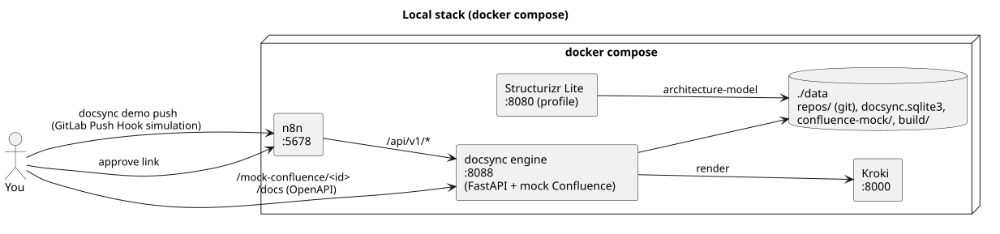

# 6. Local run and demo



## Option A: full stack with n8n (Docker)

```bash
cp .env.example .env            # mock Confluence, local git, no LLM - nothing to change
make venv                       # .venv for CLI utilities (docsync demo push) and tests
docker compose up -d --build    # docsync :8088, kroki :8000, n8n :5678
./n8n/import.sh                 # 4 workflows imported and activated
./demo/run-stack.sh             # end-to-end scenario
```

What `demo/run-stack.sh` does:

0. `docsync demo seed` - creates in `data/repos/`: `architecture-model` (from the template) and `orders-service` with three commits
   (skeleton → +gRPC to Billing → +Kafka `orders.created`); `confluence bootstrap` creates 4 pages with placeholder autoblocks.
1. `docsync demo push --step grpc` - sends a GitLab-format Push Hook to n8n (`before`=v1, `after`=v2). n8n → engine → run `PROPOSED`, branch `docsync/orders-service-…` in the model repository, a notification.
2. Opens the approve link → n8n → `approve` → branch merge → publish: 4 pages, 3 SVGs (C4 container, C4 context, sequence).
3. The same for the Kafka commit: tables, cards and C4 are refreshed (a queue appears).

Where to look:

| URL | What |
|---|---|
| http://localhost:8088/mock-confluence/ | pages "as in Confluence": hand-written text + autoblocks + SVG |
| http://localhost:8088/api/v1/runs | run journal (statuses, branches, preview) |
| http://localhost:8088/api/v1/notifications | what would have gone to Slack |
| http://localhost:8088/docs | engine OpenAPI |
| http://localhost:5678 | n8n: Executions of every workflow |
| `data/repos/architecture-model` | `git log` - DocSync commits, `changesets/*.json`, integration cards |
| `data/build/<sha>/` | manifest, XHTML blocks, puml/svg |

Manual experiments:

```bash
# manual-edit detection: change text inside an autoblock in data/confluence-mock/pages/100001.json
# (e.g. "Charge" -> "Charge (manual)") and re-publish
curl -s -X POST localhost:8088/api/v1/publish | python3 -m json.tool | grep -A3 CONFLICT

# take a change snapshot by hand, without n8n
.venv/bin/docsync extract --repo data/repos/orders-service --base <sha1> --head <sha2> --project-path payments/orders-service

# Structurizr Lite on top of the model (views from workspace.dsl)
docker compose --profile structurizr up -d   # http://localhost:8080
```

Reset: `docker compose exec docsync docsync demo reset` (or `make clean` after `docker compose down`).

## Option B: without n8n and without the engine Docker image

Only Kroki is required: `docker run -d -p 8000:8000 yuzutech/kroki`.

```bash
make venv
make demo      # = docsync demo seed && docsync demo run: bootstrap → ingest → approve → publish, two iterations, to the console
make serve     # http://localhost:8088/mock-confluence/ - browse the result
```

## Tests

```bash
make test
```

20 tests: extractor (added/removed/changed/skip, target normalization), autoblocks (replacement, idempotency, conflict, missing anchors, malformed XHTML, CDATA), model (apply/validate/generate/DSL, deprecated, Kafka topics), the end-to-end scenario (bootstrap → ingest → duplicate → approve → publish → unchanged → manual edit → CONFLICT → PARTIALLY_PUBLISHED → force) and dry-run, plus normalization of Confluence Cloud rewrites. If Kroki on `KROKI_URL` is unavailable, rendering is stubbed; with a running Kroki the tests also exercise real rendering.

## Sample output of `docsync demo run`

```
== 0. Confluence pages (bootstrap) ==
   CREATED  http://localhost:8088/mock-confluence/100001
   ...
== Scenario 1: Orders → Billing via gRPC ==
   ingest  -> PROPOSED run=72e4c9d5
      event integration_added: orders-service → billing-service [grpc] ops=['Charge', 'Refund']
      event datastore_changed: orders-service → None [None] ops=None
   model branch: docsync/orders-service-72e4c9d5  →  pages: ['Orders Service - системный анализ', 'Billing Service - системный анализ', 'Сценарий: оформление заказа', 'Payments - обзор домена']
   approve -> PUBLISHED (model 69bc2490, dryRun=False)
      PUBLISHED  Orders Service - системный анализ: orders-integrations-table=PUBLISHED, orders-integration-cards=PUBLISHED, payments-c4-containers=PUBLISHED
      ...
```
