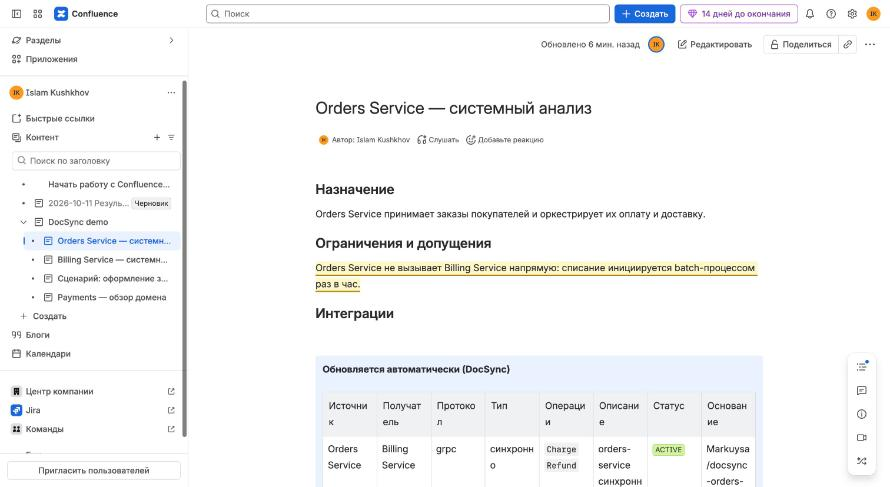
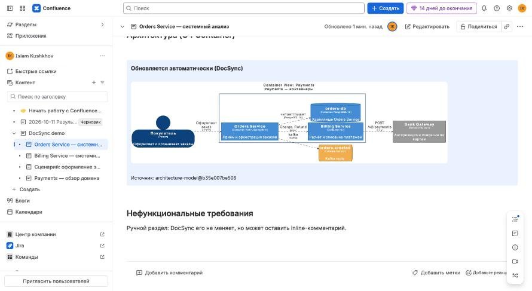

# 7. Testing on a real Confluence Cloud

The engine talks to Confluence Cloud through REST API v2 (pages, inline comments, spaces) and v1 (attachments, CQL search).

## 1. Credentials

1. https://id.atlassian.com/manage-profile/security/api-tokens → *Create API token*.
2. The technical account (or your own) must be able to view/edit pages of the space and add attachments.
3. In `.env`:

```bash
CONFLUENCE_MODE=cloud
CONFLUENCE_URL=https://<site>.atlassian.net        # without /wiki - it is appended automatically
CONFLUENCE_EMAIL=you@example.com
CONFLUENCE_API_TOKEN=<token>
CONFLUENCE_SPACE=SA                                 # space key
CONFLUENCE_PARENT_PAGE_ID=                          # optional: parent page for created pages
DOCSYNC_DRY_RUN=true                                # first run - no writes
```

Restart the engine: `docker compose up -d --build docsync` (or `make serve`).

## 2. Pages and autoblocks

```bash
docker compose exec docsync docsync confluence bootstrap
```

For every page from `docs-registry.yaml`: if `pageId` is set and the page exists - checks the anchors and appends missing placeholder autoblocks; otherwise looks the title up in the space; otherwise creates the page (`intro` + an `h2` per block + placeholder + `outro`). `pageId` is written back to the registry and committed into the model. Created pages are switched to **full width** (content-appearance properties) so that generated tables and diagrams are readable; for existing pages set the width in the page menu if needed. Open the pages in Confluence: you will see "Обновляется автоматически (DocSync)" panels between pairs of anchor macros.

Existing pages with hand-written text are attached like this: put their `pageId` into the registry and run bootstrap - only autoblocks are appended at the end; then, in the Confluence editor, move the panel with anchors to the right place on the page (the anchors must stay a `start`/`end` pair with the same `blockId`).

## 3. Dry-run, then publish

```bash
docker compose exec docsync docsync demo seed       # demo repositories (or your own architecture-model)
docker compose exec docsync docsync demo run        # with DOCSYNC_DRY_RUN=true: a report of what would change
# satisfied → DOCSYNC_DRY_RUN=false → repeat, or:
curl -s -X POST localhost:8088/api/v1/publish | python3 -m json.tool
```

After publishing, the page has: version +1 with the message `DocSync: architecture-model@<sha>`, attachments such as `payments-containers.svg` (every publish is a new attachment version, history is kept), table/cards/diagram inside the panels.

Checking hand-written text protection: edit the text inside a DocSync panel in Confluence and run publish - the report shows `CONFLICT`, the page is not changed, the other pages are refreshed.

## 4. Diagrams: SVG attachment or PlantUML macro

| Mode | How | When |
|---|---|---|
| `DOCSYNC_DIAGRAM_MODE=attachment` (default) | SVG rendered by Kroki and uploaded as an attachment; the block contains `<ac:image><ri:attachment>` | no plugins required; C4 from Structurizr and sequence |
| `DOCSYNC_DIAGRAM_MODE=macro` | PlantUML source is put into `<ac:structured-macro ac:name="<CONFLUENCE_PLANTUML_MACRO>"><ac:plain-text-body>` | sequence diagrams, when a PlantUML plugin is installed in Confluence and you want the source on the page |

The macro name depends on the plugin (Cloud macros of different vendors are named differently): insert the macro on any page by hand, open its storage format (`GET /wiki/api/v2/pages/<id>?body-format=storage`) and copy `ac:name` into `CONFLUENCE_PLANTUML_MACRO`. C4 diagrams stay SVG attachments in macro mode (their source is Structurizr DSL, not PlantUML).

## 5. LLM audit on real pages

```bash
LLM_PROVIDER=anthropic           # or openai-compatible with LLM_BASE_URL of a corporate gateway
LLM_MODEL=claude-opus-5-5
LLM_API_KEY=...
```

`docsync audit <run_id>` (or automatically from WF-02 after publishing) finds pages via CQL, gives the LLM only the hand-written text and the list of accepted changes; findings that pass the guardrails become inline comments. For "look only" - `docsync audit <run_id> --no-comments`.

## Cloud API limitations that are taken into account

* Attachment upload exists only in v1 (`PUT /rest/api/content/{id}/child/attachment`, header `X-Atlassian-Token: nocheck`).
* Confluence rewrites `ac:macro-id` and whitespace - hashes are computed after normalization.
* An inline comment requires `textSelection` to occur on the page at exactly the found position - therefore the quote is checked verbatim before the API call.
* Confluence Data Center is not supported by this client (different API paths); it can be added as a separate class in `confluence.py`.

## Acceptance run

The chain below was executed against a Confluence Cloud site and gitlab.com before the first release:

| Step | Result |
|---|---|
| `confluence bootstrap` | 4 pages created under a "DocSync demo" parent page, `pageId`s committed to the model repository in GitLab |
| GitLab push (simulated hook) → n8n → engine in `gitlab` mode | service repo cloned, ChangeSet extracted, LLM (Anthropic) wrote the Russian description, MR `!1` opened in the model project with label `docsync` |
| approve link → n8n → engine | MR `!1` merged through the GitLab API (squash), dry-run publish reported `SKIPPED_DRY_RUN` for 7 blocks, nothing written |
| `DOCSYNC_DRY_RUN=false`, publish | 4 pages updated (new version each), 3 SVG attachments uploaded |
| audit | the stale sentence "Orders Service не вызывает Billing Service напрямую…" found with confidence 0.9 → inline comment; a 0.55 finding stayed `report_only` |
| Kafka change → MR `!2` merged in GitLab → Merge Request Hook → n8n | published through the webhook path, run `PUBLISHED` |
| re-publish without changes | `UNCHANGED` for every block (after normalization of Confluence rewrites) |
| manual edit inside a panel via the API | that block `CONFLICT`, manual text preserved, other pages untouched; `force` publish took the block back |
| analyst edits `model/flows/checkout.yaml` in GitLab `main` → Push Hook | only the sequence diagram block was regenerated; the SVG now contains the gRPC `Charge` step |



The highlighted sentence carries the inline comment left by the audit; the panel below it is the autoblock.



| C4 live mode (`DOCSYNC_C4_MODE=structurizr`) | a Structurizr on-premises 2025.11.09 server started locally, workspace created through the admin API (`docsync structurizr init`), workspace pushed from the engine container with structurizr-cli on publish, C4 blocks on the real pages replaced by iframe macros pointing at `/embed/1?diagram=<view>`; the embed URL serves the live diagram without login |

Note on the live mode: the server ran on `http://localhost`, and Confluence Cloud pages are `https`, so browsers block the iframe as mixed content; the macro and the "open in Structurizr" link are on the page, the diagram itself renders once the server is served over https from a host readers can reach.

Not exercised: delivery of real GitLab webhooks to n8n (requires n8n reachable from gitlab.com - a public URL or a tunnel); the hook payloads were sent to the local n8n by hand in the exact GitLab format.
